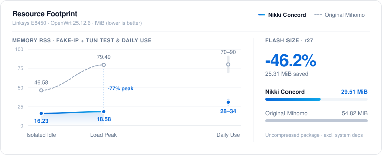

<div align="center">

# Nikki Concord

**Low-memory transparent proxy for OpenWrt · Based on OpenWrt Nikki, with the Rust Concord core and Zashboard bundled**

**[简体中文](README.md) · English**

[](https://github.com/user-7392/nikki-concord/releases/tag/v0.1.0-r32)
[](#installation)
[](#installation)
[](#upstream-projects-and-licenses)

[Flash and memory usage](#flash-and-memory-usage) · [Installation](#installation) · [Notes](#notes) · [Router adaptations](#router-adaptations) · [Building from source](#building-from-source) · [Upstream projects and licenses](#upstream-projects-and-licenses)

</div>

---

## Overview

**Nikki Concord** is a lightweight transparent proxy package for OpenWrt (**Services → Nikki Concord**).

- **Separate installation.** Own UCI config, init script, and nftables table so it can coexist with original Nikki (use core-only mode with separate ports for side-by-side testing).
- **Lower memory and flash usage.** Powered by the Rust [Concord](https://github.com/Vialibrex/concord) core with router-tuned `jemalloc`.
- **All-in-one package.** Bundles Concord, classic & modern LuCI UI (classic by default), Chinese translations, [Zashboard](https://github.com/Zephyruso/zashboard), and in-LuCI one-click upgrades.

> [!NOTE]
> Concord is in pre-1.0 development; packages are published as prereleases. Stop other transparent proxies before switching traffic to Nikki Concord.

---

## Flash and memory usage

<picture>
  <source media="(prefers-color-scheme: dark)" srcset="assets/benchmark-en-dark.svg" />
  <source media="(prefers-color-scheme: light)" srcset="assets/benchmark-en-light.svg" />
  
</picture>

**Daily use on the E8450 (maintainer’s dashboard observation).** Nikki Concord r27 used about **28–34 MiB RSS**. The chart’s idle and peak figures come from a roughly 50-second isolated benchmark with DNS Fake-IP and TUN enabled on both sides. The daily observation covers real client traffic with TCP redirection and UDP over TUN.

<details>
<summary>View detailed numbers, isolated load test setup, and results</summary>

| Metric | Original Nikki 1.26.2 + Mihomo v1.19.34 | Nikki Concord | Reduction |
| :--- | ---: | ---: | ---: |
| **Flash** (total uncompressed installed files) | **54.82 MiB** | r27 **29.51 MiB** | **25.31 MiB (46.2%)** |
| **Memory** (combined service-process RSS) | Idle **46.58 MiB** · Peak **79.49 MiB** | r27 idle **16.23 MiB** · Peak **18.58 MiB** | Idle **30.35 MiB** · Peak **60.91 MiB** |

- **Prior daily use of the original build.** Original Nikki + Mihomo used about **40 MiB** idle and **70–90 MiB** during normal use on the maintainer’s router.
- **Flash measurement.** The Concord figure uses the uncompressed files in the r27 E8450 (aarch64_cortex-a53) APK. The total includes the core and other bundled files. Shared system dependencies and files downloaded or cached at runtime are excluded. Filesystem compression affects actual usage. Leave room to unpack and replace files during an upgrade.
- **r27 isolated test setup.** Both services ran in turn on a Linksys E8450 with OpenWrt 25.12.6 in an isolated network. They used the same subscription with 48 local SOCKS5 test nodes and eight rule sets totaling 120,290 rules, seven from the router's cache. Both enabled DNS Fake-IP, Fake-IP persistence, and TUN. The client resolves a different test hostname for each request, checks that DNS returns a Fake-IP, and sends TCP traffic through TUN. Idle RSS is the median of five samples. RSS was sampled about once per second under load. Concord's RSS includes the core and logging process.
- **Results.** Each service completed 1,000 HTTPS requests with zero failures at about 20 new requests per second, up to 32 concurrent requests, over about 50 seconds. About 60% went through proxy nodes and 40% went direct. Both reached about **2.54 MiB/s**. After 30 seconds idle, original Nikki was at **79.50 MiB** and Concord at **18.55 MiB**. The test covered Fake-IP DNS and TCP HTTPS over TUN in an isolated network. Public proxy nodes, application UDP traffic, and maximum throughput were outside its scope.

</details>

---

## Installation

### Supported firmware and architectures

| Item | Details |
| --- | --- |
| **Firmware** | **OpenWrt 25.12.x** (`apk`), and **OpenWrt / ImmortalWrt 23.05 / 24.10** with `opkg` + `firewall4` (feeds must provide Go `yq` and `rpcd-mod-ucode`; `iptables / fw3` is unsupported) |
| **Architectures** | `aarch64_cortex-a53` · `aarch64_cortex-a72` · `aarch64_generic` · `x86_64` |
| **Packages** | Both **`.apk`** (25.12+) and **`.ipk`** (23.05 / 24.10) per architecture; kernel module dependencies come from firmware feeds |

> [!WARNING]
> Only `.apk` has been tested on physical OpenWrt 25.12 hardware. `.ipk` packages were checked for structure and control scripts only—back up your router config before installing on 23.05 or 24.10.

### 1. Check your firmware and architecture

```sh
# Firmware version
cat /etc/openwrt_release

# OpenWrt 25.12+ (apk)
cat /etc/apk/arch

# OpenWrt / ImmortalWrt 23.05 and 24.10 (opkg)
opkg print-architecture
```

### 2. Download the matching package

Download the package for your architecture from the [v0.1.0-r32 release](https://github.com/user-7392/nikki-concord/releases/tag/v0.1.0-r32). Checksums are in `SHA256SUMS-r32-all`.

| Architecture | OpenWrt 25.12+ (`.apk`) | OpenWrt / ImmortalWrt 23.05 and 24.10 (`.ipk`) |
| :--- | :--- | :--- |
| `aarch64_cortex-a53` | `luci-app-nikki-concord-0.1.0-r32.apk` | `luci-app-nikki-concord-0.1.0-r32_aarch64_cortex-a53.ipk` |
| `aarch64_cortex-a72` | `luci-app-nikki-concord-0.1.0-r32_aarch64_cortex-a72.apk` | `luci-app-nikki-concord-0.1.0-r32_aarch64_cortex-a72.ipk` |
| `aarch64_generic` | `luci-app-nikki-concord-0.1.0-r32_aarch64_generic.apk` | `luci-app-nikki-concord-0.1.0-r32_aarch64_generic.ipk` |
| `x86_64` | `luci-app-nikki-concord-0.1.0-r32_x86_64.apk` | `luci-app-nikki-concord-0.1.0-r32_x86_64.ipk` |

> [!NOTE]
> **Optional LightGBM experimental branch.** The main build already supports `smart` proxy groups natively (heuristic scoring), which is sufficient for most users. If you specifically want `uselightgbm: true` model inference, download [**v0.1.0-r32-lgbm**](https://github.com/user-7392/nikki-concord/releases/tag/v0.1.0-r32-lgbm) from the separate experimental branch (kept out of `main` and ignored by the main build's Check Update).

### 3. Install, enable, and upgrade

Upload the package to your router and substitute its filename in the matching command.

```sh
# OpenWrt 25.12+ (apk)
apk add --allow-untrusted ./package.apk

# OpenWrt / ImmortalWrt 23.05 and 24.10 (opkg)
opkg update && opkg install ./package.ipk
```

> [!TIP]
> - **First start.** The service is disabled after a fresh install. Open **Services → Nikki Concord**, configure your subscription/profile, enable the service, and save.
> - **Upgrades.** Use **Check Update → Upgrade Now** in the LuCI status bar (`apk` and `opkg` supported; user configuration is preserved).
> - **UI switcher.** Opens in the classic LuCI UI by default; click **Modern UI** on the right side of the App Config subtitle row to switch anytime.

---

## Notes

Key behavioral differences from Mihomo (full protocol and field list: [Concord compatibility](https://github.com/Vialibrex/concord/blob/faaadad9c93d1967d44a65732bfcb02b7a93aefc/docs/compatibility.md)):

| Area | Details |
| :--- | :--- |
| **TUN** | Configure TUN via top-level `tun:` (`type: tun` inside `listeners` is not opened). Legacy stack names `mips`, `mixed`, `system`, and `gvisor` all use Concord's userspace stack. |
| **Rule sets and GeoIP** | Keep local rule/proxy providers under `/etc/nikkic/run/core/` with relative paths. `SAFE_PATHS`, custom `GeoIP.dat`, and `BundleMRS.7z` are unsupported. |
| **DNS** | `dns.fallback-filter` defaults to `geoip: false` (set explicitly with an MMDB to match Mihomo). `dhcp://<interface>` is treated as `system://`—use explicit upstream DNS servers if dnsmasq forwards to Concord to avoid loops. |
| **Dashboard and Fast Reload** | A non-loopback controller requires an API secret; clear both controller addresses to disable it. With Fast Reload enabled, click **Restart Service** after changing controller address, secret, TLS, or dashboard URL. |

---

## Router adaptations

- **Memory and flash wear.** Linux musl builds use router-tuned `jemalloc` (4 KiB pages, single arena, prompt reclamation) and cap `/group/:name/delay` at 10 concurrent probes; `profile.store-fake-ip` batches writes in 30-second windows.
- **Networking and config.** Optional IPv6-first TCP dialing for proxy servers (**Mixin Config → General Config**); unknown top-level Mihomo keys are ignored silently while preserving YAML anchors; reloads and upgrades preflight configs and preserve the running state on error.
- **Dashboard and logs.** Built-in controller serves Zashboard and HTTPS with `POST /upgrade/geo`, rule hit stats, and temporary per-rule disabling; application and core logs are each capped at **1 MiB** (trimmed to ~256 KiB).

---

## Building from source

You need `git`, `python3`, `node`, `gzip`, `unzip`, `po2lmo` from the OpenWrt LuCI SDK (on `PATH` or under `build/`), Concord's pinned Rust toolchain, and `zig` and `cargo-zigbuild` for Linux musl targets.

<details>
<summary>Cross-build and packaging commands</summary>

```sh
mkdir -p build/dashboard release
git clone https://github.com/Vialibrex/concord.git build/concord-src
git -C build/concord-src checkout --detach "$(cat core/upstream-revision)"
git -C build/concord-src apply "$PWD/core/concord.patch"
git -C build/concord-src apply "$PWD/core/concord-openwrt-controller.patch"

cpu=aarch64
arch=aarch64_cortex-a53
target="$cpu-unknown-linux-musl"

mkdir -p build/zig-bin
printf '#!/bin/sh\nexec zig ar "$@"\n' > build/zig-bin/ar
printf '#!/bin/sh\nexec zig ranlib "$@"\n' > build/zig-bin/ranlib
chmod +x build/zig-bin/ar build/zig-bin/ranlib

(cd build/concord-src && PATH="$PWD/../zig-bin:$PATH" \
  JEMALLOC_SYS_WITH_LG_PAGE=12 \
  JEMALLOC_SYS_WITH_MALLOC_CONF="background_thread:false,dirty_decay_ms:0,muzzy_decay_ms:0,narenas:1,tcache:false" \
  cargo zigbuild --locked --release --target "$target" -p concord-desktop)

gzip -n -9 -c "build/concord-src/target/$target/release/concord" > "build/concord-$cpu.gz"
unzip -q assets/zashboard-v3.30.0.zip -d build/zashboard-extract
cp -R build/zashboard-extract/dist/. build/dashboard/

python3 build-root.py --direct-core --cpu "$cpu" --core "build/concord-$cpu.gz" "build/package-$cpu"
node check-luci.mjs "build/package-$cpu"

# Package for OpenWrt 25.12+ (.apk)
python3 pack.py "build/package-$cpu" "release/luci-app-nikki-concord-0.1.0-r32_$arch.apk"

# Package for OpenWrt / ImmortalWrt 23.05 & 24.10 (.ipk)
python3 pack.py "build/package-$cpu" "release/luci-app-nikki-concord-0.1.0-r32_$arch.ipk"
```

The three ARM64 package architectures (`aarch64_cortex-a53`, `aarch64_cortex-a72`, and `aarch64_generic`) share the `cpu=aarch64` build. Set `arch` to select the package architecture. For x86-64, set both `cpu` and `arch` to `x86_64`.

</details>

---

## Upstream projects and licenses

| Project | Role | Source and notices |
| :--- | :--- | :--- |
| [**OpenWrt Nikki**](https://github.com/nikkinikki-org/OpenWrt-nikki) | Service scripts and LuCI base | The repository includes the v1.26.2 source used for builds and its license. |
| [**Concord**](https://github.com/Vialibrex/concord) | Rust proxy core | The pinned revision and project patches are under `core/`. Upstream third-party licenses are retained with the source. |
| [**Zashboard v3.30.0**](https://github.com/Zephyruso/zashboard/releases/tag/v3.30.0) | Bundled web dashboard | Upstream licenses and third-party notices are retained. |

---

<div align="center">

<sub>Built collaboratively by **Human + GPT + Gemini** · Developed with regular rest and reasonable working hours, free from inhumane coercion.</sub>

</div>
