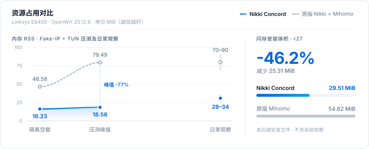

<div align="center">

# Nikki Concord

**面向 OpenWrt 的低内存透明代理插件 · 基于 OpenWrt Nikki 移植，内置 Rust Concord 内核与 Zashboard 面板**

**简体中文 · [English](README.en.md)**

[](https://github.com/user-7392/nikki-concord/releases/tag/v0.1.0-r31)
[](#下载安装)
[](#下载安装)
[](#上游项目与许可)

[闪存与内存占用](#闪存与内存占用) · [下载安装](#下载安装) · [注意事项](#注意事项) · [路由器适配](#路由器适配) · [从源码构建](#从源码构建) · [上游项目与许可](#上游项目与许可)

</div>

---

## 简介

**Nikki Concord** 是面向 OpenWrt 的轻量透明代理插件，LuCI 入口为 **服务 → Nikki Concord**。

- **独立并存**：独立配置、启动脚本与 nftables 防火墙表，可与原版 Nikki 隔离开箱体验（并存测试请启用「仅核心模式」并错开端口）。
- **低内存、省闪存**：内置 Rust 编写的 [Concord](https://github.com/Vialibrex/concord) 内核，搭配路由器向 `jemalloc` 调优，显著降低闪存与内存占用。
- **单包集成**：单包内含 Concord 核心、双风格 LuCI 界面（默认经典版，支持一键切新版）、简繁中文与 [Zashboard](https://github.com/Zephyruso/zashboard) 面板，并支持 LuCI 内一键升级。

> [!NOTE]
> Concord 仍处于 pre-1.0 迭代阶段，发布包以 **Pre-release** 提供。启用透明代理前请先停止其他代理服务。

---

## 闪存与内存占用

<picture>
  <source media="(prefers-color-scheme: dark)" srcset="assets/benchmark-zh-dark.svg" />
  <source media="(prefers-color-scheme: light)" srcset="assets/benchmark-zh-light.svg" />
  
</picture>

**E8450 日常使用（维护者面板观察）**：Nikki Concord r27 约 **28–34 MiB RSS**。图中的空载和峰值来自约 50 秒的隔离压测，两边均开启 DNS Fake-IP 和 TUN。日常观察来自真实客户端，接管方式为 TCP 重定向、UDP TUN。

<details>
<summary>查看详细数据表、隔离压测条件与实测说明</summary>

| 对比项 | 原版 Nikki 1.26.2 + Mihomo v1.19.34 | Nikki Concord | 相对原版变化 |
| :--- | ---: | ---: | ---: |
| **闪存占用**（整套安装文件，压缩前） | **54.82 MiB** | r27 **29.51 MiB** | **少 25.31 MiB（-46.2%）** |
| **内存占用**（服务进程 RSS 合计） | 空载 **46.58 MiB** · 压测峰值 **79.49 MiB** | r27 空载 **16.23 MiB** · 压测峰值 **18.58 MiB** | 空载 **-30.35 MiB** · 峰值 **-60.91 MiB** |

- **原版日常使用观察（历史）**：原版 Nikki + Mihomo 在维护者自用环境中空载约 **40 MiB**，日常运行约 **70–90 MiB**。
- **闪存统计口径**：Concord 使用 r27 的 E8450（aarch64_cortex-a53）APK，按解包后文件合计，包含核心和插件自带组件，未计入系统公共依赖、运行后下载的数据与缓存。实际占用受文件系统压缩影响，升级时请预留解包和替换空间。
- **r27 隔离压测条件**：Linksys E8450，OpenWrt 25.12.6。两套服务在隔离网络轮流测试，共用 48 个本地 SOCKS5 测试节点的订阅与 8 个规则集（120,290 条规则，7 份来自实机缓存），两边均开启 DNS Fake-IP、Fake-IP 缓存持久化和 TUN。客户端为每次请求解析不同的测试域名，校验 DNS 返回 Fake-IP，并通过 TUN 发送 TCP 流量。空载取 5 次 RSS 采样的中位数，压测期间约每秒采样一次。Concord 的 RSS 包含核心和日志进程。
- **压测结果**：每秒约 20 个新建 HTTPS 请求，最多 32 个并发，持续约 50 秒。两边分别完成 1,000 个请求（约六成经节点转发、四成直连），零失败，两边吞吐均约 **2.54 MiB/s**。停压 30 秒后，原版为 **79.50 MiB**，Concord 为 **18.55 MiB**。本轮覆盖隔离网络中的 DNS Fake-IP 与 TUN 上的 TCP HTTPS，公网节点、应用 UDP 流量及极限吞吐未纳入对照。

</details>

---

## 下载安装

### 适用范围

| 项目 | 说明 |
| --- | --- |
| **系统固件** | **OpenWrt 25.12.x**（`apk`），以及使用 `opkg` + `firewall4 (nftables)` 的 **OpenWrt / ImmortalWrt 23.05 / 24.10**（需软件源提供 Go 版 `yq` 和 `rpcd-mod-ucode`；不支持 `iptables / fw3`） |
| **支持架构** | `aarch64_cortex-a53` · `aarch64_cortex-a72` · `aarch64_generic` · `x86_64` |
| **打包格式** | 各架构均提供 **`.apk`**（25.12+）与 **`.ipk`**（23.05 / 24.10），内核模块依赖由固件软件源解析 |

> [!WARNING]
> 维护者仅在 OpenWrt 25.12 实机上测试过 `.apk`；`.ipk` 仅经过包结构与脚本校验，在 23.05 / 24.10 安装或升级前请先备份配置。

### 1. 确认固件版本与架构

```sh
# 查看固件版本
cat /etc/openwrt_release

# OpenWrt 25.12+ (apk) 查看架构
cat /etc/apk/arch

# OpenWrt / ImmortalWrt 23.05 & 24.10 (opkg) 查看架构
opkg print-architecture
```

### 2. 下载对应安装包

前往 [**v0.1.0-r31 发布页**](https://github.com/user-7392/nikki-concord/releases/tag/v0.1.0-r31) 下载与设备架构匹配的包（校验值见发布页 `SHA256SUMS-r31-all`）：

| 架构 | OpenWrt 25.12+（`.apk`） | OpenWrt / ImmortalWrt 23.05 & 24.10（`.ipk`） |
| :--- | :--- | :--- |
| `aarch64_cortex-a53` | `luci-app-nikki-concord-0.1.0-r31.apk` | `luci-app-nikki-concord-0.1.0-r31_aarch64_cortex-a53.ipk` |
| `aarch64_cortex-a72` | `luci-app-nikki-concord-0.1.0-r31_aarch64_cortex-a72.apk` | `luci-app-nikki-concord-0.1.0-r31_aarch64_cortex-a72.ipk` |
| `aarch64_generic` | `luci-app-nikki-concord-0.1.0-r31_aarch64_generic.apk` | `luci-app-nikki-concord-0.1.0-r31_aarch64_generic.ipk` |
| `x86_64` | `luci-app-nikki-concord-0.1.0-r31_x86_64.apk` | `luci-app-nikki-concord-0.1.0-r31_x86_64.ipk` |

> [!NOTE]
> **可选 LightGBM 实验分支**：主包本身已原生支持 `smart` 策略组（启发式选线），绝大多数用户直接使用主包即可。如需 `uselightgbm: true` 模型推理，可前往独立实验分支发布页下载 [**v0.1.0-r31-lgbm**](https://github.com/user-7392/nikki-concord/releases/tag/v0.1.0-r31-lgbm)（不合入 `main`，主包「检查更新」会自动忽略该标签）。

### 3. 安装、启用与后续升级

将对应安装包上传到路由器后执行：

```sh
# OpenWrt 25.12+ (apk)
apk add --allow-untrusted ./文件名.apk

# OpenWrt / ImmortalWrt 23.05 & 24.10 (opkg)
opkg update && opkg install ./文件名.ipk
```

> [!TIP]
> - **首次启用**：安装后默认关闭，在 **服务 → Nikki Concord** 填好订阅/配置、勾选「启用」并保存即可。
> - **在线升级**：后续可在状态栏点击「检查更新 → 立即升级」，支持 `apk` / `opkg` 自动校验安装并保留配置。
> - **界面切换**：默认经典 LuCI 界面，可在「插件配置」副标题右侧切换至移动端适配的新版界面。

---

## 注意事项

与 Mihomo 的主要行为差异（完整协议与字段清单见 [Concord 上游兼容性说明](https://github.com/Vialibrex/concord/blob/69423a87d008b9016ddd23089ba738ee58c04fad/docs/compatibility.md)）：

| 分类 | 说明 |
| :--- | :--- |
| **TUN** | TUN 须通过顶层 `tun:` 配置（`listeners` 里的 `type: tun` 不会启用）；`mips`、`mixed`、`system`、`gvisor` 均使用同一个 Concord 用户态栈。 |
| **规则与 GeoIP** | 本地规则集/代理集须放在 `/etc/nikkic/run/core/` 下使用相对路径；不支持 `SAFE_PATHS`、自定义 `GeoIP.dat` 与 `BundleMRS.7z`。 |
| **DNS** | `dns.fallback-filter` 默认 `geoip: false`（需沿用 Mihomo 默认时请显式配置并提供 MMDB）。`dhcp://<接口>` 按 `system://` 处理，若 dnsmasq 转发给 Concord 且系统 DNS 指向 dnsmasq，请使用明确上游 DNS 避免环路。 |
| **面板与快速重载** | 对外监听控制器须设置 API 密钥，清空控制器地址即可关闭面板；开启快速重载时，修改控制器地址、密钥、TLS 或面板链接后需点击「重启服务」。 |

---

## 路由器适配

- **低内存与防抖**：musl 构建使用低内存调优的 `jemalloc`（4 KiB 页、单 arena、主动退页），`/group/:name/delay` 测速限并发 10；开启 `profile.store-fake-ip` 时按 30 秒窗口合并落盘，减少闪存写入。
- **网络与配置**：支持「代理服务器 TCP 优先 IPv6」（默认关闭，可在混入配置开启）；静默忽略 Mihomo 未知顶层字段并保留 YAML 锚点；重载与升级前先做配置预检，失败时保留当前运行配置。
- **面板与运维**：内置控制器托管 Zashboard 与 HTTPS，支持 `POST /upgrade/geo`、规则命中统计与临时禁用单条规则；应用/核心日志各限 **1 MiB** 自动截断保留约 256 KiB。

---

## 从源码构建

构建环境需准备：`git`、`python3`、`node`、`gzip`、`unzip`、OpenWrt LuCI SDK 的 `po2lmo`（加入 `PATH` 或放入 `build/`）、Concord 源码固定的 Rust 工具链，以及支持 Linux musl 目标的 `zig` 与 `cargo-zigbuild`。

<details>
<summary>展开完整交叉编译与打包命令</summary>

```sh
mkdir -p build/dashboard release
git clone https://github.com/Vialibrex/concord.git build/concord-src
git -C build/concord-src checkout --detach "$(cat core/upstream-revision)"
git -C build/concord-src apply "$PWD/core/concord.patch"
git -C build/concord-src apply "$PWD/core/concord-openwrt-controller.patch"

cpu=aarch64
arch=aarch64_cortex-a53
target="$cpu-unknown-linux-musl"

mkdir -p build/zig-bin
printf '#!/bin/sh\nexec zig ar "$@"\n' > build/zig-bin/ar
printf '#!/bin/sh\nexec zig ranlib "$@"\n' > build/zig-bin/ranlib
chmod +x build/zig-bin/ar build/zig-bin/ranlib

(cd build/concord-src && PATH="$PWD/../zig-bin:$PATH" \
  JEMALLOC_SYS_WITH_LG_PAGE=12 \
  JEMALLOC_SYS_WITH_MALLOC_CONF="background_thread:false,dirty_decay_ms:0,muzzy_decay_ms:0,narenas:1,tcache:false" \
  cargo zigbuild --locked --release --target "$target" -p concord-desktop)

gzip -n -9 -c "build/concord-src/target/$target/release/concord" > "build/concord-$cpu.gz"
unzip -q assets/zashboard-v3.30.0.zip -d build/zashboard-extract
cp -R build/zashboard-extract/dist/. build/dashboard/

python3 build-root.py --direct-core --cpu "$cpu" --core "build/concord-$cpu.gz" "build/package-$cpu"
node check-luci.mjs "build/package-$cpu"

# 打包 OpenWrt 25.12+ (.apk)
python3 pack.py "build/package-$cpu" "release/luci-app-nikki-concord-0.1.0-r31_$arch.apk"

# 打包 OpenWrt / ImmortalWrt 23.05 & 24.10 (.ipk)
python3 pack.py "build/package-$cpu" "release/luci-app-nikki-concord-0.1.0-r31_$arch.ipk"
```

ARM64 三种架构（`aarch64_cortex-a53`、`aarch64_cortex-a72`、`aarch64_generic`）共用 `cpu=aarch64` 的编译产物，打包时替换 `arch` 即可；构建 `x86_64` 时将 `cpu` 和 `arch` 均设为 `x86_64`。

</details>

---

## 上游项目与许可

| 项目 | 作用 | 说明 |
| :--- | :--- | :--- |
| [**OpenWrt Nikki**](https://github.com/nikkinikki-org/OpenWrt-nikki) | 服务脚本与 LuCI 基础实现 | 仓库保留用于构建的 v1.26.2 源码与对应许可 |
| [**Concord**](https://github.com/Vialibrex/concord) | Rust 代理内核 | 固定上游提交与本项目补丁位于 `core/`，第三方许可随源码保留 |
| [**Zashboard v3.30.0**](https://github.com/Zephyruso/zashboard/releases/tag/v3.30.0) | 内置网页面板 | 仓库保留原有许可与第三方声明 |

---

<div align="center">

<sub>本项目由 **Human + GPT + Gemini** 共同协作完成 · 全程遵循正常作息与合理工作时长，不存在任何非人道行为压迫</sub>

</div>
